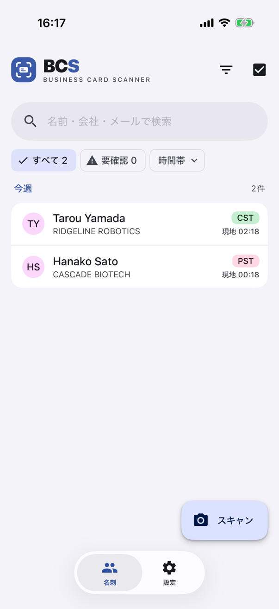
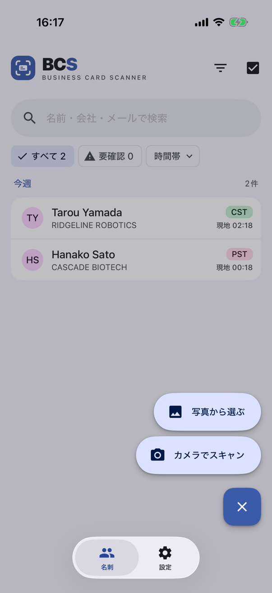
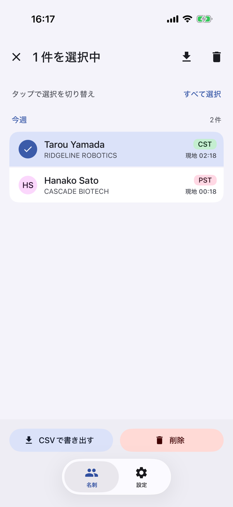
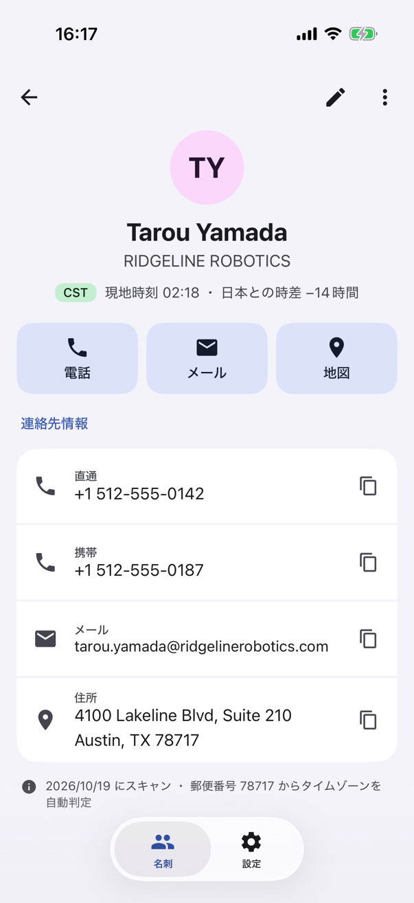
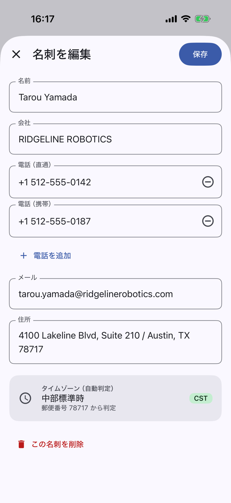
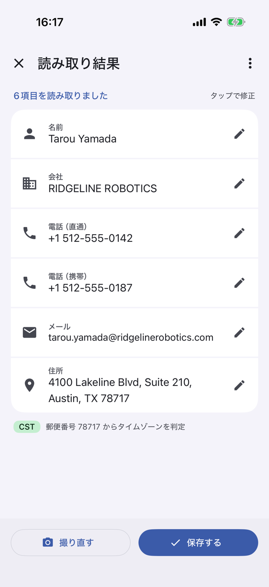
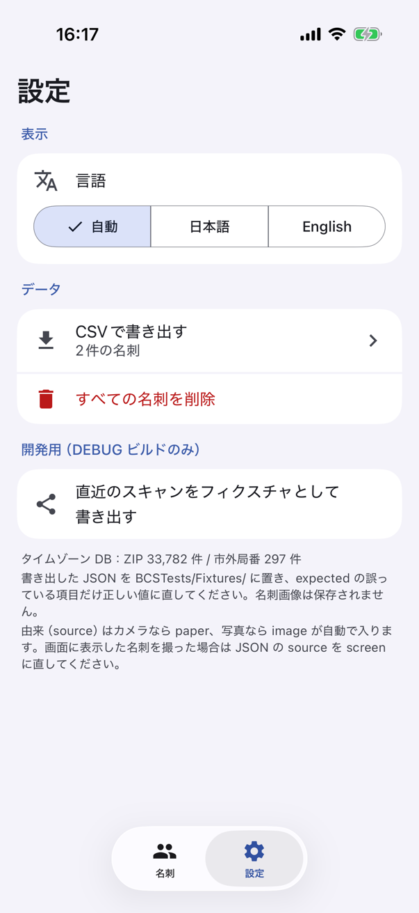

# BCS — 米国の英語名刺向け 読み取り・タイムゾーン判定アプリ

米国の英語名刺を iPhone で撮るだけで、氏名・会社・電話・メール・住所を自動で読み取り、CSV で書き出せる iOS アプリです（日本語の名刺には未対応）。
住所の郵便番号（または電話の市外局番）から時間帯（PST / MST / CST / EST）を判定し、相手の現地時刻も表示します。

業務で発生していた「もらった名刺を手で入力する」「電話をかける前に相手の現地時刻を調べる」作業を効率化するために開発した個人開発プロジェクトです。
読み取りの精度だけでなく、**読み取りが怪しい項目を人が見落とさないこと**を重視して設計しています。

## 特徴

* **撮るだけで項目分け** — 書類カメラで撮るか写真から選ぶだけで、氏名・会社・電話・メール・住所に振り分けます
* **相手の現地時刻がすぐ分かる** — 時間帯を自動判定し、一覧に現地時刻、詳細に日本との時差を表示します
* **怪しい項目には「要確認」** — 電話番号の桁が合わない、会社名をメールアドレスから推測した、などの項目に印を付け、読み取った元の文字も残します
* **保存前に確認・修正** — 読み取り直後に結果画面で確認でき、「保存する」を押すまで保存しません
* **探しやすい一覧** — 名前・会社・メールで検索、要確認・時間帯で絞り込み、並び替え、今週 / それ以前に分けて表示します
* **Excel でそのまま開ける CSV** — 文字化けしない形式で書き出し、要確認と読み取り元の列も付けます
* **名刺のデータを外に出さない** — 名刺は相手の個人情報なので、サーバーを使わず端末内だけで処理します。名刺画像も保存しません

## 画面

| 一覧 | スキャンメニュー | 複数選択 | 詳細 |
|:--:|:--:|:--:|:--:|
|  |  |  |  |

| 編集 | 読み取り結果 | 設定 |
|:--:|:--:|:--:|
|  |  |  |

## 対応している名刺

| 項目 | 読み取り方 |
| --- | --- |
| レイアウト | 1 列・左右 2 列の英語名刺。2 行に分かれたロゴの会社名（例: `CASCADE` / `BIOTECH`）にも対応 |
| 電話のラベル | `TEL` `Phone` `Office` `T` `O` → 代表、`Direct` `D` → 直通、`Mobile` `Cell` `M` `C` → 携帯、`Fax` `F` → 読み込まない |
| 電話番号の形式 | 米国の番号は `+1 512-555-0142` の形にそろえます。内線付き・海外の番号は読み取ったまま残します |
| 時間帯 | 米国の住所のみ。郵便番号を優先し、取れないときは電話の市外局番から判定します |

※ 日本語の名刺は未対応です（今後の改善点を参照）。

## 「要確認」の意味

| 表示 | 付く条件 |
| --- | --- |
| 電話番号の桁数が合いません | 米国の番号として数字の桁数が合わない |
| 読み取れませんでした | 氏名・会社・住所が空 |
| メールアドレスから推測しました | 名刺に会社名が見つからず、メールアドレスのドメインから会社名を作った |
| 郵便番号と市外局番の判定が異なります | 両方から時間帯が取れて、結果が食い違う |

編集でその項目を書き換えると自動で外れます。詳細画面の「確認済みに」でまとめて外すこともできます。

## 使い方

```bash
git clone https://github.com/shu8719/BCS.git
cd BCS
open BCS.xcodeproj
```

Xcode 16 以降でスキーム `BCS` を選び、実機でビルドしてください（カメラを使うため）。
テストは Xcode の Cmd+U で実行できます。

`sample/` に動作確認用の名刺画像（架空の人物・会社）があります。
iPhone の写真に保存し、「スキャン」→「写真から選ぶ」で読み込むと、実際の読み取り結果を確認できます。

## 技術スタック

| 分類 | 技術 |
| --- | --- |
| 言語 / UI | Swift 5 / SwiftUI（iOS 17 以降） |
| 文字認識 | Vision（`VNRecognizeTextRequest`）/ VisionKit の書類カメラ |
| データ保存 | 端末内の JSON ファイル |
| 時間帯の判定 | 米国の郵便番号・市外局番の対応表（CSV をアプリに同梱） |
| デザイン | Figma → Asset Catalog（色・アイコン） |
| テスト | XCTest / XCUITest |

サーバーや外部ライブラリを使わず、Apple 標準のフレームワークだけで動く構成にしています。

## プロジェクト構成

```text
BCS/
├── App/            # アプリの起動・タブ
├── Views/          # 画面（一覧・詳細・編集・読み取り結果・設定・カメラ）
├── OCR/            # Vision による文字認識
├── Parsing/        # 読み取った文字を氏名・会社・電話・住所に振り分ける処理
├── TimeZone/       # 郵便番号・市外局番から時間帯を判定（対応表 CSV を含む）
├── Model/          # 名刺データと保存
├── Support/        # 日英の文言・CSV 書き出し・検索や絞り込み
├── DesignSystem/   # 色・文字・アイコンと共通部品
└── DevTools/       # 開発用（精度評価用の書き出しなど、DEBUG ビルドのみ）
BCSTests/           # ユニットテストと、実際の名刺の読み取り結果（精度評価用）
BCSUITests/         # 画面操作の自動テスト
sample/             # 動作確認用の名刺画像
```

処理の流れは `画面 → 読み取り（OCR → Parsing）→ 時間帯の判定 → 保存` の一方向になるよう設計しています。

## 読み取りの流れ

1. **文字の読み取り** — Vision で名刺画像から文字とその位置を取り出します
2. **行の組み立て** — 同じ高さの文字を 1 行にまとめ、離れているものは左右の列に分けます（2 列の名刺対策）
3. **住所** — 番地や「州 + 郵便番号」を手がかりに住所の行を見つけ、続きの行とつなげます
4. **電話** — 番号を探し、近くのラベルから直通・代表・携帯を決めます。FAX は除きます
5. **メール・会社・氏名** — メールは `@` で確定し、会社名はメールのドメインと一致する行を優先します。氏名は文字の大きさ・位置・メールの名前部分との一致から選びます
6. **仕上げ** — 電話番号の形をそろえ、怪しい項目に「要確認」を付けます
7. **時間帯** — 郵便番号（なければ市外局番）から時間帯を判定します

## 工夫した点

### 読み取りが怪しいところを隠さない

文字認識は完璧ではないので、自信のない項目には「要確認」を付け、読み取った元の文字も一緒に残しています。
保存前の確認画面と一覧の絞り込みで、直すべき名刺だけをすぐ見つけられるようにしました。

### 実際の名刺で精度を測れるようにした

読み取りのルールを 1 つ直すと、別の名刺で失敗するようになることがあります。
そこで、名刺の読み取り結果（文字と位置）と正しい答えをセットで保存し、テストで全件の正解率を出せるようにしました。ルールを直すたびに、他の名刺が壊れていないかを数字で確認できます（名刺画像そのものは保存しません）。

### iPhone の言語設定に左右されない時間帯判定

最初は時間帯の略称（EST など）を iOS から取得していましたが、日本語設定の iPhone では「GMT-4」のような表記になり、判定がすべて空になる不具合がありました。
言語設定に関係しない「標準時との時差」から判定する方法に変え、どの設定でも同じ結果になるようにしています。

### アップデートしてもデータが消えない

保存するデータの形を変えたときも、以前の形式のデータをそのまま読み込めるようにしています。
万一読み込めないファイルがあっても上書きせず、別名で残します。

## 今後の改善点

* 精度評価に使う名刺を増やし、読み取りが弱いところを洗い出す
* 読み取りが怪しい項目を AI で補う
  * 端末内で動く Apple の AI（Foundation Models）を使い、名刺のデータは外に出さない
  * AI には新しい文字を作らせず、OCR が読んだ行から「どれが会社名・氏名か」を選ばせる。AI が埋めた項目には「要確認」を付ける
* 日本語名刺への対応（日本語の文字認識と振り分け。表記のパターンが多くルールで書き切るのが難しいため、AI に行を選ばせる方式を前提に設計する）
* SwiftData + iCloud による端末間の同期
