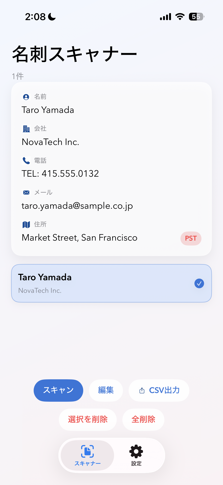
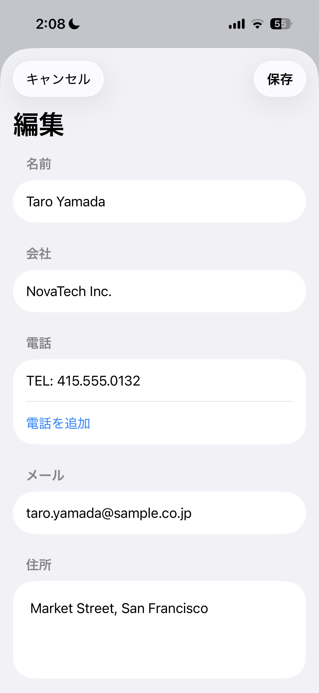

# BCS - Business Card Scanner

SwiftUI と Apple Vision フレームワークを用いた iOS 名刺スキャンアプリです。
カメラで名刺を撮影するだけで氏名・会社・電話・メール・住所を自動抽出し、CSV でエクスポートできます。
米国の名刺に対しては、住所の郵便番号または電話番号の市外局番から PST・MST・CST・EST を自動判定する機能も実装しています。
OCR と、独自のパーサーパイプラインを組み合わせることで、レイアウトが異なる名刺にも高精度で対応します。

---

## 主な機能

| 機能 | 概要 |
|------|------|
| 名刺スキャン | VNDocumentCameraViewController でカメラ撮影、または写真ライブラリの画像 → Vision OCR でテキスト認識 |
| 自動情報抽出 | 氏名・会社・電話・メール・住所をスコアリングベースで自動分類。米国の電話番号は `+1 NXX-NXX-XXXX` に整形 |
| 読み取り結果の確認 | スキャン直後に結果画面で各項目を確認・修正し、「保存する」を押すまで永続化しない |
| 要確認フラグ | 書式を補正した項目、読み取れなかった名前・会社、郵便番号と市外局番でタイムゾーンが食い違う名刺に「要確認」を付け、一覧・詳細・結果画面で表示 |
| タイムゾーン推定 | 米国住所の郵便番号 / 市外局番から PST・MST・CST・EST を自動判定。一覧と詳細に相手の現地時刻を表示 |
| 一覧・検索・絞り込み | 名前・会社・メールで検索、要確認 / 会社 / 時間帯で絞り込み、今週 / それ以前でグループ表示 |
| 複数選択 | 長押しで選択モード。選択した名刺の CSV 書き出しと削除 |
| 詳細・編集 | 電話 / メール / 地図へのクイックアクション、項目のコピー、編集シート（変更した項目の要確認は自動解除） |
| CSV 出力 | RFC 4180 / UTF-8 BOM 形式（Excel・Numbers 対応）。`needs_review` と `raw_value` 列を含む |
| 日英対応 | 設定のセグメントボタンで 端末に合わせる / 日本語 / English を切替 |
| 削除 Undo | 削除後 6 秒以内であればワンタップで復元（単体・複数・全削除） |

---

## スクリーンショット

| カード一覧 | 編集画面 |
|:-----------:|:--------:|
|  |  |

> 画像は旧 UI のものです。Material 3 ベースの新 UI（Figma: `UI_REDESIGN_HANDOFF.md` 参照）のスクリーンショットは実機撮影後に差し替えます。

---

## 技術スタック

- **言語**: Swift 5.10
- **UI**: SwiftUI（Material 3 のトークンを Asset Catalog の Color Set / SVG Image Set で管理）
- **OCR**: Vision / VisionKit (`VNRecognizeTextRequest`)
- **カメラ**: `VNDocumentCameraViewController`
- **並行処理**: Swift Concurrency（`async/await`、`Task.detached`）
- **永続化**: Documents ディレクトリ（JSON ファイル・アトミック書き込み）
- **最小 iOS**: 17.0

---

## アーキテクチャ

```
BCSApp
└── RootView (TabView)
    ├── CardListView         # 01 一覧 / 02 複数選択（検索・絞り込み・週グループ・FAB）
    │   ├── CardDetailView   # 03 詳細（要確認バナー・クイックアクション）
    │   │   └── CardEditView # 04 編集シート
    │   └── ScanFlow         # FAB → ScannerView / 写真 → ScanResultView (06) → CardStore.append
    └── SettingsView         # 07 設定（DEBUG ビルドでは開発用ツールも表示）

OCR
  TextRecognizer       Vision の VNRecognizeTextRequest をラップ（カメラ・写真読み込みで共用）

パーサーパイプライン（CardParser）
  OCR テキスト群
    → 行の再構築      Y 座標でグループ化し、列ギャップで分割
    → AddressParser    住所ブロック検出・マルチライン結合
    → PhoneParser      電話番号抽出・ラベル付与・重複除去
    → NameParser       スコアリングによる人名候補選定
    → ReviewFlagger    電話番号の整形（PhoneNormalizer）と「要確認」の付与

モデル
  BusinessCard         各項目は ContactField（値・読み取り元・要確認理由）。v1 の JSON も読める
  CardStore            永続化・複数削除・Undo・要確認解除

タイムゾーン
  TimeZoneResolver     ZIP（優先）/ 市外局番 → TimeZoneResolution（zone・根拠・食い違い）
  TimeZoneLookupTable  CSV 由来の検索テーブル（遅延ロード）

デザインシステム（DesignSystem/）
  M3 / BCSTextStyle / BCSIcon と Components/（Avatar, Chip, Button, FieldRow, OutlinedTextField など）
```

---

## 技術的なこだわり

### 1. OCR 後の多段パーサーパイプライン

Vision OCR が返すテキストは座標付きの断片の集合です。このアプリでは以下の順で処理します。

1. **行の再構築** — Y 座標・X 座標を基に断片を行に統合し、列のギャップも検出
2. **住所検出** — `NSDataDetector` + 正規表現 + スコアリングで住所ブロックを特定。連続する行を縦方向にマージし、インデントされた続行行も回収
3. **電話番号抽出** — 正規表現 2 パターン + `NSDataDetector` で二重取得し、ラベル（TEL / Mobile / Direct）と数字を対応付け
4. **人名選定** — 文字高さ・Y 座標・TitleCase 判定・メールアドレスのヒントなどを総合したスコアで候補をランキング

### 2. タイムゾーン推定の非同期化

米国郵便番号 DB（`uszips.csv`・数万行）は起動時にバックグラウンドでプリロードします。
タイムゾーン解決処理は `Task.detached` でメインスレッドを解放し、結果を `MainActor` で UI に反映します。

```swift
Task {
    let updates = await Task.detached(priority: .utility) {
        TimeZoneResolver.resolveUpdates(for: snapshot) // CSV lookup はここ（バックグラウンド）
    }.value
    // ここは MainActor — @State への書き込みが安全
    for update in updates { ... }
}
```
---

## ファイル構成

```
BCS/
├── App/
│   ├── BCSApp.swift            エントリーポイント
│   └── RootView.swift          TabView ルート
├── DesignSystem/
│   ├── M3Color.swift           Color Set への型付きアクセス
│   ├── BCSTextStyle.swift      タイポグラフィ
│   ├── BCSIcon.swift           SVG アイコンの enum + IconView
│   └── Components/             BrandWordmark, InitialsAvatar, TimeZoneChip, BCSButton, FilterChip,
│                               SearchBar, SectionHeader, ReviewBanner, FieldRow, OutlinedTextField, ...
├── Views/
│   ├── CardList/               CardListView（01/02）, ContactRow
│   ├── CardDetail/             CardDetailView（03）, CardDetailText（文言生成）
│   ├── CardEdit/               CardEditView（04）, FieldEditSheet, CardEditLogic
│   ├── Scan/                   ScanFlow, ScanFlowPresentation, ScanResultView（06）, PhotoImport
│   ├── Settings/SettingsView.swift  07 設定
│   ├── ScannerView.swift       カメラ（VNDocumentCameraViewController）
│   └── ShareSheet.swift        UIActivityViewController ラッパー
├── OCR/
│   ├── TextRecognizer.swift    Vision OCR ラッパー
│   └── OCRTypes.swift          OCRItem / OCRLine
├── Parsing/
│   ├── CardParser.swift        OCR 断片 → BusinessCard（パイプライン本体）
│   ├── AddressParser.swift     住所ブロック検出・結合・整形
│   ├── PhoneParser.swift       電話番号抽出・ラベル付与
│   ├── NameParser.swift        人名スコアリング
│   ├── PhoneNormalizer.swift   米国番号を +1 NXX-NXX-XXXX に
│   ├── ReviewFlagger.swift     要確認フラグの付与
│   └── ParserUtils.swift       KeywordMatcher などの共通ユーティリティ
├── Model/
│   ├── BusinessCard.swift      ContactField / USTimeZone / TimeZoneSource、v1 互換デコード
│   ├── CardStore.swift         永続化・複数削除・Undo・要確認解除
│   └── AppSettings.swift       言語設定の永続化
├── TimeZone/
│   ├── TimeZoneResolver.swift  ZIP・市外局番 → TimeZoneResolution
│   ├── TimeZoneLookupTable.swift CSV 由来の検索テーブル
│   ├── uszips.csv              米国郵便番号 → タイムゾーン
│   └── ac-tz.csv               米国市外局番 → タイムゾーン
├── Support/
│   ├── L10n.swift              日英ローカライズ
│   ├── CSVExporter.swift       CSV 生成（RFC 4180 / BOM / CRLF / needs_review / raw_value）
│   ├── CardListFilter.swift    検索・絞り込み・並び替え・週グループ
│   └── LocalTime.swift         現地時刻・日本との時差
├── DevTools/
│   ├── CardFixture.swift       テスト用フィクスチャの JSON モデル
│   └── FixtureRecorder.swift   直近の OCR 結果を保持（DEBUG のみ）
├── Assets.xcassets
└── InfoPlist.xcstrings         カメラ権限文言の日英訳
BCSTests/
├── Fixtures/                   名刺ごとの OCR 結果 + 期待値（JSON）
├── FixtureAccuracyTests.swift  全フィクスチャの項目別正解率
├── FixtureEvaluator.swift      正解率の集計と正規化ルール
├── CardParserTests.swift       パイプライン全体・行の再構築
├── ParserUtilsTests.swift      キーワード判定（単語境界）
├── PhoneParserTests.swift      電話番号抽出・FAX 除外・重複除去
├── AddressParserTests.swift    住所行判定・複数行結合
├── NameParserTests.swift       人名選定
├── TimeZoneResolverTests.swift タイムゾーン判定・DB 読み込み・食い違い
├── CSVExporterTests.swift      CSV エスケープ・ヘッダー・要確認列
├── ContactFieldTests.swift / BusinessCardCodableTests.swift  モデルと v1 互換デコード
├── PhoneNormalizerTests.swift / ReviewFlaggerTests.swift     整形と要確認フラグ
├── CardStoreTests.swift        永続化・複数削除・Undo
├── CardListFilterTests.swift / LocalTimeTests.swift          一覧ロジック
├── CardDetailTextTests.swift / CardEditLogicTests.swift      詳細文言・編集時の解除規則
├── InitialsAvatarTests.swift   イニシャルとアバター色
└── ScanFlowTests.swift         スキャン → 結果 → 保存の状態遷移
```

---

## 精度の検証（フィクスチャ）

パーサーの精度は、本物の名刺の OCR 結果を保存したフィクスチャで測ります。名刺画像は保存せず、
Vision が返したテキストと座標、および期待値だけを JSON にします。

1. DEBUG ビルドで設定タブを開き、「開発用」セクションを使う
   - **写真から OCR してパース**: 写真ライブラリの画像をカメラを通さずに OCR する（再現性が高い）
   - **直近のスキャンをフィクスチャとして書き出す**: カメラまたは写真から直近に処理した結果を JSON にして共有シートへ（AirDrop で Mac に送る）
2. 受け取った JSON を `BCSTests/Fixtures/` に置く
3. `expected` にはパーサーの現在の出力が入っているので、間違っている項目だけ正しい値に直す
   - 項目を削除すると、その項目はチェック対象外になる
   - `phones` は数字だけを比較、`address` は英数字だけを比較するので表記ゆれは無視される
4. Xcode で Cmd+U。`FixtureAccuracyTests` が全フィクスチャを流し、ログに項目別の正解率を出す

```
Fixture accuracy (20 fixtures)
  name      17/20   85.0%
  company   15/20   75.0%
  ...
Failures:
  [paper_acme_20261016_173000] name: expected "John Smith" / actual "Sales Manager"
```

`FixtureAccuracyTests.minimumAccuracy` の下限値は最初 0 になっています。フィクスチャが 20 枚程度そろったら
基準値を設定し、以降の改修で下回ったらテストが失敗するようにしてください。

---

## セットアップ

```bash
git clone https://github.com/shu8719/BCS.git
cd BCS
open BCS.xcodeproj
```

Xcode でスキームを選択し、実機または Simulator でビルドしてください。
カメラを使用するため、実機での動作を推奨します。

> **Required**: Xcode 16+ / iOS 17+

---

## 今後の改善案

- [ ] OCR 言語設定の追加（日本語名刺対応）
- [ ] ダークモード対応（Color Set に Dark を追加するだけで済む構造）
- [ ] カスタムカメラ（Figma 05: ガイド枠・自動撮影・検出チップ）。現状は VisionKit の標準 UI
- [x] パーサーのユニットテスト追加（`BCSTests`）
- [ ] SwiftData への移行
